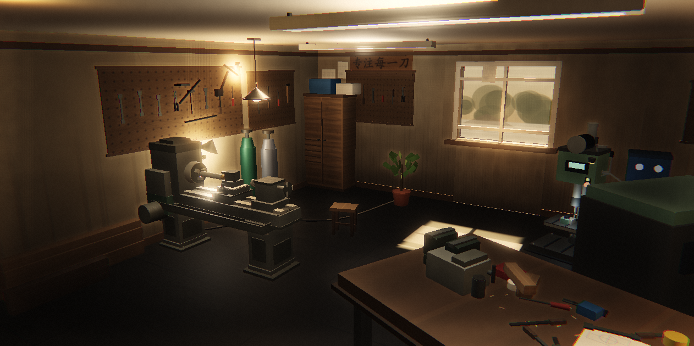

# 我的工作室 · WORKSHOP

> 一间属于自己的 3D 木工房。接单、练手艺、攒设备、做作品——从一台旧车床开始，把它做成能接活的工作室。

**▶ 在线试玩**：<https://你的GitHub用户名.github.io/workshop-game/>
**🧩 形态**：单个 HTML 文件，双击即玩，无需安装、无需联网、无需后端
**🛠 技术**：Three.js r160 + 自写后期管线（SSAO / Bloom / ACES / 分离色调）
**📜 许可**：[AGPL-3.0](LICENSE) — 商业使用需单独授权，见 [COMMERCIAL.md](COMMERCIAL.md)
**✉️ 合作**：见下方「合作洽谈」



---

## 这是什么

一个**网页 3D 经营小游戏**。你继承了一间空屋子，只有一台旧车床和一些基本工具。
通过接订单挣钱、练技能、买设备，逐步把这间屋子填满，最后做出自己的作品。

游戏是**单机、纯前端**的：没有服务器、没有账号、没有内购，存档在浏览器 `localStorage` 里。
整个游戏被打包成**一个 HTML 文件**（约 860KB），双击就能玩，也可以直接丢到任何静态托管上。

---

## 玩法

| 循环 | 说明 |
|---|---|
| **接单** | 订单板每天刷新，按难度和报酬挑活 |
| **做工** | 消耗时间格推进工序，技能等级决定成败与品质 |
| **练手** | 花时间练车/焊/设计/CNC，等级越高，能接的活越好 |
| **买设备** | 车床、台钻、焊机、3D 打印机、显微镜、CNC，逐台解锁 |
| **做作品** | 攒齐零件做自己的作品，作品能持续带来声望 |

一天分若干个时间格，空了可以「空过一格」。声望和资金决定你能走多远。

---

## 技术上做了什么

这个项目刻意**不引入任何框架、构建工具或素材文件**，所有内容在运行时程序化生成：

- **单文件构建**：`template.html` + `three.min.js` + `game.js` 三段拼成一个 HTML
- **自写后期管线**：`WebGLRenderTarget` → SSAO（深度重建法线 + 半球采样 + 双向模糊）→ 三级高斯 Bloom → ACES 色调映射 + 色差 + 暗角 + 噪点 + 分离色调
- **程序化贴图**：Sobel 从 canvas 高度图求切线空间法线（铸铁麻面 / 木纹 / 抹灰砂粒），配粗糙度乘数图
- **倒角几何**：`chamferBox()` 生成 24 顶点硬倒角方块，替代 `BoxGeometry`，消除「积木感」
- **七套车间主题**：木工房 / 赛博朋克 / 极简 / 现代 / 工作室 / 实用 / 复古，运行时整体换灯光、材质、后期
- **iPad 适配**：单指旋转 + 双指捏合，窄屏自动切抽屉式布局，`dpr`/阴影图按设备封顶

> 想看渲染是怎么一步步调到这个样子的：`docs/preview.png` 是最终效果。

---

## 快速开始

### 直接玩
```bash
# 双击 index.html 即可（file:// 就能跑）
```
⚠️ 注意：`file://` 下 `localStorage` 在部分浏览器会被禁用，存档可能不保存。
想稳定存档，用本地服务器：

```bash
python -m http.server 8080
# 然后打开 http://localhost:8080
```

### 从源码构建
```bash
node build.js        # 或 npm run build
# -> 生成 index.html
```

只需要 Node.js，**没有 npm 依赖**（Three.js 已内联在 `src/`）。

### 目录
```
index.html            # 构建产物 = 可直接玩的单文件（也是 Pages 入口）
build.js              # 拼装脚本
src/
  template.html       # 页面骨架 + 全部 UI 样式
  game.js             # 游戏逻辑 + 3D 场景 + 后期管线（约 3800 行）
  three.min.js        # Three.js r160（MIT，内联）
docs/preview.png      # 截图
```

---

## 操作

| | 桌面 | iPad / 触摸 |
|---|---|---|
| 转视角 | 按住拖动 | 单指拖动 |
| 远近 | 滚轮 | 双指捏合 |
| 菜单 | `Esc` | 右上角「菜单」 |
| 空过一格 | `空格` | 顶部「空过一格」 |

在 iPad 上用 Safari 打开后，**分享 → 添加到主屏幕**，可以全屏运行，像个 App。

---

## 许可与合作

本项目以 **GNU AGPL-3.0** 发布。

简单说：

- ✅ 你可以自由地**阅读、学习、修改、自己玩、非商业分发**
- ✅ 你可以 fork 它、拿它的渲染代码去做别的项目（只要那个项目也开源）
- ⚠️ 如果你把它（或改过的版本）**放到网上给别人用**，AGPL 要求你也公开全部源码
- ❌ **商业使用需要单独授权** —— 包括卖、内购、广告变现、嵌进商业产品、做付费课程

这样做的目的很简单：**想商用的人，来找我谈。** 谈成了给你一份不受 AGPL 约束的商业许可。

详见 [COMMERCIAL.md](COMMERCIAL.md)。

---

## 合作洽谈

如果你对下面任何一件事感兴趣，欢迎联系：

- 商业授权（把你的产品里用上这套渲染 / 这套玩法）
- 定制开发（换题材、换风格、接你的业务场景，比如产品展示、培训模拟）
- 一起把它做成完整产品（美术、关卡、叙事、发行）
- 单纯想交流技术（程序化贴图、自写 SSAO、单文件打包）

**联系方式**

- 📮 邮箱：`<在这里填你的邮箱>`
- 💬 GitHub：开一个 [Issue](../../issues/new/choose)，标题以 `[合作]` 开头
- 🐛 Bug / 建议：同样走 Issue，用对应模板

> 我会看每一条 Issue。合作类请简单说明：你是谁、想做什么、大概什么规模。

---

## 已知限制

诚实列一下目前不够好的地方（欢迎 PR）：

- **车床仍是低模**：缺手柄、丝杠、卡盘齿、铭牌、油污，是最明显的「游戏感」来源
- **阳光只有贴片光斑**：地面那块窗光是一张按太阳方向投影的加法贴片，墙体和家具本身没吃到这束光，近看会露
- **SSAO 是简化版**：只用深度重建法线、没有法线缓冲，掠射角会有轻微噪点
- **没有音效资源**：音效全部是 WebAudio 实时合成
- **只有一套场景**：七套主题是换皮，不是七个不同的屋子

---

## 致谢

- [Three.js](https://threejs.org/) — MIT，见 [NOTICE.md](NOTICE.md)
- 所有几何、贴图、音效均为代码生成，**不含任何第三方美术资源**

---

<sub>© 2026 <你的署名>. 代码以 AGPL-3.0 授权；「我的工作室 / WORKSHOP」的名称、玩法设计与美术呈现保留所有权利。</sub>
